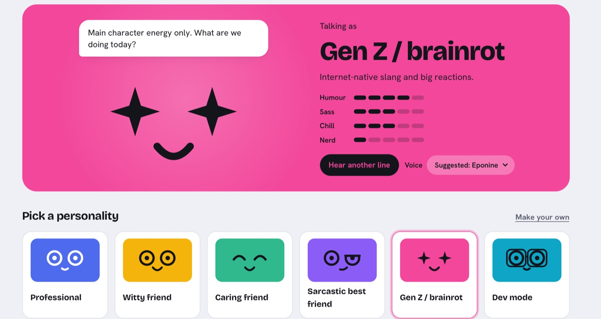

# Rubidu

**A private AI voice assistant that lives in your Mac's menu bar as a tiny face and does what you say.**
Everything runs on your Mac: the speech recognition, the AI model and the voice. No account, no cloud,
no tracking. It works offline.

**Website:** https://ujjwal-ismyname.github.io/rubidu/ · **Join the waitlist** on the site to hear when it is out.

> This repository holds Rubidu's public website and this description. Rubidu itself is proprietary,
> closed-source software; its code is not published here.

## What it does

- **Talk, and it does it.** Open apps, set timers and reminders, play and pause music (YouTube included),
  change volume, brightness, Wi-Fi, Bluetooth and dark mode, read your calendar and mail, do exact maths and
  unit conversions, search the web.
- **Dictate into any app.** Hold two keys and speak; your words appear where the cursor is, offline.
- **Still hears you over a video.** It cancels what your Mac is playing out of the microphone.
- **Read this to me, transcribe this.** Have any selected text read aloud, or turn a recording into text.
- **Personalities, with written humour.** A witty friend, a sarcastic best friend, a caring friend, a
  professional, a developer who plays rubber duck, Gen Z, and an adults-only mode, each with its own voice.
  Ask it to roast your Mac. It never jokes at your expense.
- **Say it your way.** Teach it your accent and how to say your name; Hinglish and several other languages work.
- **Presenting mode.** Say "I'm presenting" and it turns professional and hides its bubble and sticky note.
- **A desktop sticky note, focus sessions with a coach, quizzes, and a one-press reset of everything.**

## Private by design, and checkable

Turn Wi-Fi off and it still works. Watch your network monitor and see it connect to nothing. It asks for four
macOS permissions (microphone, input monitoring, accessibility, screen recording), says what each is for, and
lets you take any of them back in one press. See [Is Rubidu private?](https://ujjwal-ismyname.github.io/rubidu/is-rubidu-private.html)
and [Is it safe for my Mac?](https://ujjwal-ismyname.github.io/rubidu/will-rubidu-slow-down-my-mac.html).

## Honest limits

Apple silicon Macs only (M1 or newer, macOS 26.3 or later). Its AI is small enough to run on your Mac, so it is
quick and private but not as broad as a big cloud chatbot; commands are exact, chat answers are short. English
works best. It is made by one independent developer and is not signed with an Apple developer certificate, so
macOS asks you to confirm it once the first time you open it ([how, with pictures](https://ujjwal-ismyname.github.io/rubidu/how-to-open-rubidu.html)).

## Guides

[A private Siri alternative for Mac](https://ujjwal-ismyname.github.io/rubidu/siri-alternative-mac.html) ·
[A voice assistant for work](https://ujjwal-ismyname.github.io/rubidu/ai-voice-assistant-for-work-on-mac.html) ·
[How students use it](https://ujjwal-ismyname.github.io/rubidu/ai-assistant-for-students.html) ·
[Terms and refunds](https://ujjwal-ismyname.github.io/rubidu/terms-and-refunds.html)

## Contact

Feedback and questions: use the form on the website. Mac and Siri are trademarks of Apple Inc., which is not affiliated with Rubidu.
